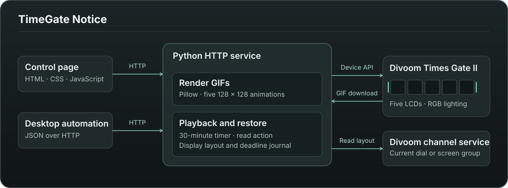

# TimeGate Notice

在 Divoom Times Gate II 的五块屏幕上播放文字和表情包的局域网服务。

## 功能

- 实时预览。文字按完整字符排版，表情单独占一块屏，支持 GIF、PNG、JPEG 和 WebP。
- 文字闪烁、表情循环播放。第五屏右下角显示发送时间，设备氛围灯使用选定颜色。蜂鸣提示可按需开启，默认关闭。
- 通知最多显示 30 分钟。点击「标为已读」即可提前恢复原表盘或屏组，页面显示处理状态。
- 桌面自动化可用 HTTP API 发送通知、上传表情、查询状态和恢复画面。

## 架构

浏览器和桌面自动化访问同一个 Python HTTP 服务。Pillow 将内容生成五份 128×128 GIF，设备通过局域网拉取并播放。服务保存原显示布局和恢复时间，定时或按已读请求恢复画面。

## 使用

在配置设备地址和字体后运行 `python3 service.py`。安装、用户级 systemd 配置和 API 示例见[部署与接口](docs/deployment.md)。
